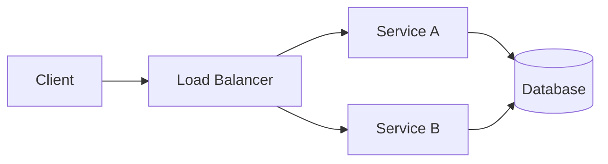

Lorem ipsum dolor sit amet, consectetur adipiscing elit. Sed do eiusmod tempor
incididunt ut labore et dolore magna aliqua. Ut enim ad minim veniam, quis
nostrud exercitation ullamco laboris nisi ut aliquip ex ea commodo consequat.

## Why this post exists

Duis aute irure dolor in reprehenderit in voluptate velit esse cillum dolore eu
fugiat nulla pariatur. Excepteur sint occaecat cupidatat non proident, sunt in
culpa qui officia deserunt mollit anim id est laborum.

A few things this blog supports:

- Markdown headings, lists, and quotes
- Inline math like $e^{i\pi} + 1 = 0$
- Display math and diagrams

> Sed ut perspiciatis unde omnis iste natus error sit voluptatem accusantium
> doloremque laudantium.

## A little math

The Gaussian integral is a useful sanity check for the math pipeline:

$$
\int_{-\infty}^{\infty} e^{-x^{2}}\,dx = \sqrt{\pi}
$$

And a slightly more involved identity:

$$
\sum_{n=1}^{\infty} \frac{1}{n^{2}} = \frac{\pi^{2}}{6}
$$

## A diagram



Nemo enim ipsam voluptatem quia voluptas sit aspernatur aut odit aut fugit, sed
quia consequuntur magni dolores eos qui ratione voluptatem sequi nesciunt.

## Code, for good measure

```ts
function debounce<T extends (...args: never[]) => void>(fn: T, ms: number) {
    let timer: ReturnType<typeof setTimeout>;

    return (...args: Parameters<T>) => {
        clearTimeout(timer);
        timer = setTimeout(() => fn(...args), ms);
    };
}
```

Neque porro quisquam est, qui dolorem ipsum quia dolor sit amet, consectetur,
adipisci velit, sed quia non numquam eius modi tempora incidunt ut labore et
dolore magnam aliquam quaerat voluptatem.
